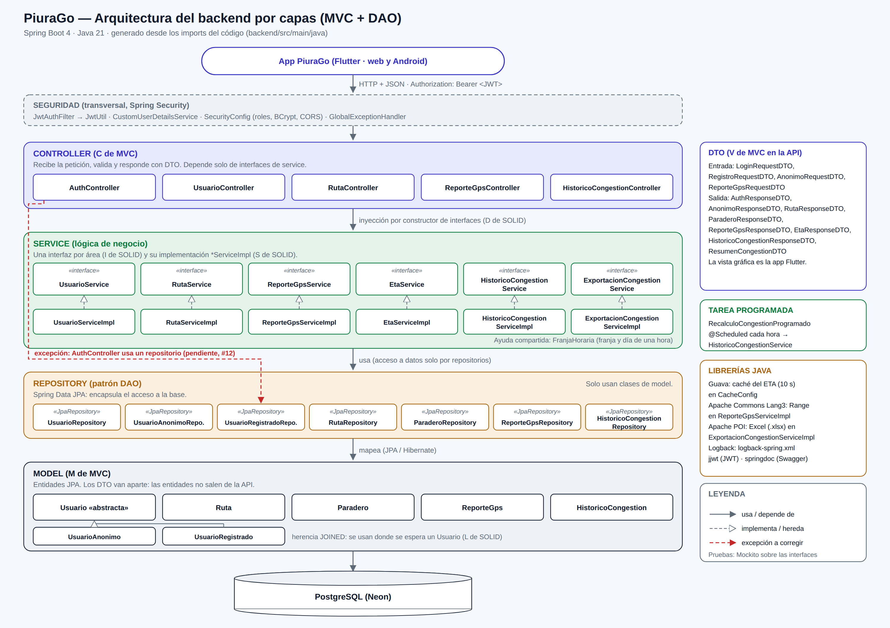

# Arquitectura del backend por capas (MVC + DAO)

- **Fuentes:** `arquitectura-capas.svg` (vectorial) y `arquitectura-capas.png` (para el informe), generados con `generar_arquitectura.py`.
- **Contenido:** las dependencias salen de los imports de `backend/src/main/java`. Incluye lo de los PR #47 (congestión por tramos y tarea programada) y #51 (exportación a Excel con Apache POI).

## Capas

| Capa | Paquete | Qué hace | Regla del curso |
|---|---|---|---|
| Controller (C de MVC) | `controller/` | Recibe la petición HTTP, valida y responde con DTO | Depende solo de interfaces de service |
| DTO (V de MVC en la API) | `dto/` | Datos de entrada y salida de la API, separados de las entidades | Las entidades no salen de la API |
| Service | `service/` y `service/impl/` | Lógica de negocio: una interfaz por área y su `*ServiceImpl` | Accede a datos solo por repositorios |
| Repository (DAO) | `repository/` | Interfaces de Spring Data JPA que encapsulan el acceso a PostgreSQL | Solo usa clases de `model/` |
| Model (M de MVC) | `model/` | Entidades JPA | — |
| Seguridad (transversal) | `security/` | JWT, roles, BCrypt y CORS | — |

## Dependencias reales entre clases

```mermaid
flowchart TD
    subgraph Controller
        AuthController
        UsuarioController
        RutaController
        ReporteGpsController
        HistoricoCongestionController
    end
    subgraph Service
        UsuarioService
        RutaService
        ReporteGpsService
        EtaService
        HistoricoCongestionService
        ExportacionCongestionService
    end
    subgraph Repository["Repository (DAO)"]
        UsuarioRepository
        UsuarioAnonimoRepository
        UsuarioRegistradoRepository
        RutaRepository
        ParaderoRepository
        ReporteGpsRepository
        HistoricoCongestionRepository
    end

    AuthController --> UsuarioService
    AuthController -. "pendiente #12" .-> UsuarioRegistradoRepository
    UsuarioController --> UsuarioService
    RutaController --> RutaService
    ReporteGpsController --> ReporteGpsService
    ReporteGpsController --> EtaService
    HistoricoCongestionController --> HistoricoCongestionService
    HistoricoCongestionController --> ExportacionCongestionService
    RecalculoCongestionProgramado["RecalculoCongestionProgramado (@Scheduled)"] --> HistoricoCongestionService

    UsuarioService -- UsuarioServiceImpl --> UsuarioAnonimoRepository
    UsuarioService -- UsuarioServiceImpl --> UsuarioRegistradoRepository
    RutaService -- RutaServiceImpl --> RutaRepository
    RutaService -- RutaServiceImpl --> ParaderoRepository
    ReporteGpsService -- ReporteGpsServiceImpl --> ReporteGpsRepository
    ReporteGpsService -- ReporteGpsServiceImpl --> RutaRepository
    ReporteGpsService -- ReporteGpsServiceImpl --> UsuarioRepository
    EtaService -- EtaServiceImpl --> ReporteGpsService
    EtaService -- EtaServiceImpl --> RutaRepository
    EtaService -- EtaServiceImpl --> ParaderoRepository
    EtaService -- EtaServiceImpl --> HistoricoCongestionRepository
    HistoricoCongestionService -- HistoricoCongestionServiceImpl --> HistoricoCongestionRepository
    HistoricoCongestionService -- HistoricoCongestionServiceImpl --> ReporteGpsRepository
    HistoricoCongestionService -- HistoricoCongestionServiceImpl --> RutaRepository
    HistoricoCongestionService -- HistoricoCongestionServiceImpl --> ParaderoRepository
    ExportacionCongestionService -- ExportacionCongestionServiceImpl --> HistoricoCongestionRepository
```

## Excepción pendiente

`AuthController` usa `UsuarioRegistradoRepository` directamente para buscar al usuario por correo, en lugar de pedírselo a `UsuarioService`. Rompe la regla "controller no usa repository" (issue #12).

Cuando se corrija, hay que borrar la flecha roja en `generar_arquitectura.py` y la línea `pendiente #12` de este archivo, y volver a generar el diagrama.
