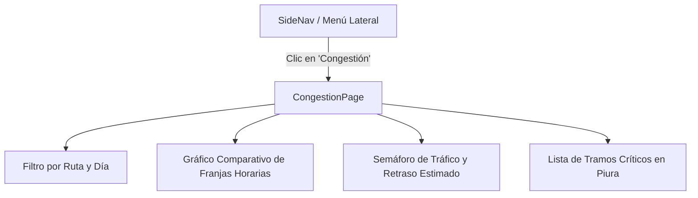
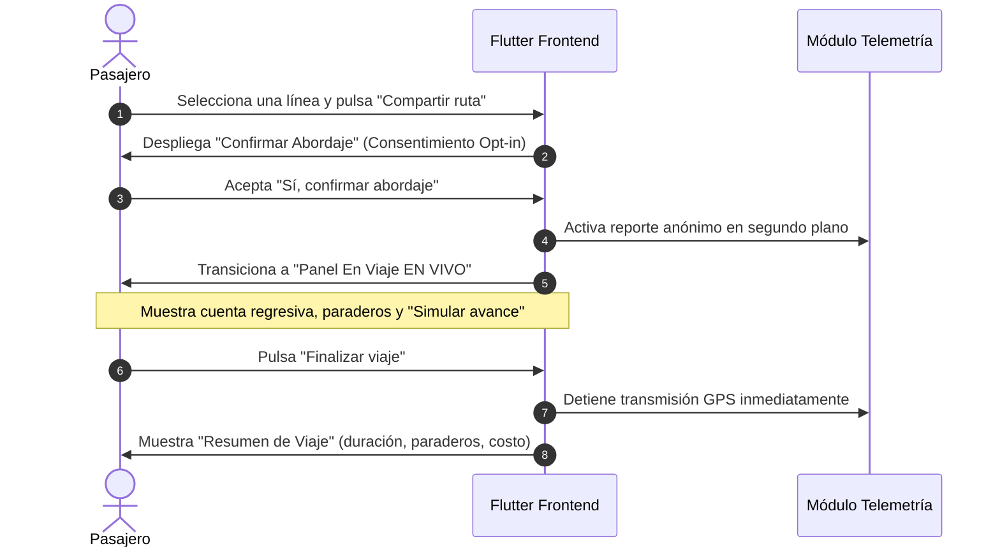

# Reporte Técnico de Avance — Proyecto PiuraGo (APF3)

**Proyecto:** PiuraGo — Sistema Colaborativo de Monitoreo y Rutas de Transporte Urbano en Piura  
**Curso:** Integrador I (Sistemas / Software) — Universidad Tecnológica del Perú (UTP)  
**Hito:** Avance de Proyecto Final 3 (APF3)  
**Fecha de corte:** 26 de octubre de 2026  
**Metodología:** MVC + DAO + SOLID + Test-Driven Development (TDD)  

---

## 1. Resumen Ejecutivo

Durante esta fase de desarrollo se implementaron dos componentes críticos pendientes del sistema, completando la cobertura de los prototipos oficiales de diseño y los requerimientos funcionales del proyecto:

1. **Módulo de Monitoreo de Congestión en Piura (RF-04 / Prototipo 08):** Visualización analítica de tráfico vehicular por franjas horarias, identificación de tramos críticos de la ciudad, semáforo de estado y estimación de demoras promedio.
2. **Flujo de Abordaje y Viaje en Vivo Colaborativo (Prototipos 05, 06 y 07):** Mecanismo de recolección de telemetría GPS voluntaria (*opt-in*), panel de seguimiento de ruta en tiempo real con tiempos estimados entre paraderos y resumen de viaje al finalizar.

Ambos módulos se desarrollaron bajo estricto cumplimiento de **TDD**, logrando **178 pruebas automatizadas aprobadas en el frontend**, **39 pruebas unitarias aprobadas en el backend** y **0 incidencias de análisis estático**.

---

## 2. Configuración y Compatibilidad del Entorno

| Componente | Tecnología / Versión | Estado / Configuración |
|---|---|---|
| **Backend** | Java 21, Spring Boot 4.1.1, Spring Data JPA, Spring Security | Validado con JDK 25 (`C:\Program Files\Java\jdk-25.0.4`) y Neon PostgreSQL |
| **Frontend** | Flutter 3.47.1, Dart 3.13.1, Flutter Map + OpenStreetMap | SDK ajustado en `pubspec.yaml` a `^3.13.0` para compatibilidad local |
| **Base de Datos** | PostgreSQL en Neon (São Paulo) | Validada y sincronizada |
| **Servidor de Pruebas** | Flutter Web (Google Chrome) | Desplegado y verificado localmente |

---

## 3. Módulo 1: Pantalla de Congestión en Piura (RF-04)

### 3.1 Descripción y Alcance
Cumple con el **Requerimiento Funcional 04 (RF-04)**, permitiendo a los usuarios consultar el estado del tráfico vehicular en la ciudad y anticipar retrasos en sus desplazamientos.

### 3.2 Componentes Desarrollados
- **Vista Principal:** `frontend/lib/features/congestion/congestion_page.dart`
  - **Gráfico de Franjas Horarias:** Comparación visual entre *Mañana pico (07:00 - 09:00)*, *Medio día (12:30 - 14:30)*, *Tarde pico (18:00 - 20:30)* y *Noche (21:00 - 23:00)*.
  - **Tarjeta de Estado General:** Nivel de congestión actual (Alto, Moderado, Fluido) codificado en semáforo visual con cálculo de retraso promedio (`+18 min`).
  - **Tramos Críticos Reportados:** Lista detallada de avenidas vulnerables de Piura (Av. Sánchez Cerro, Av. Grau, Óvalo Cáceres, Puente Sánchez Cerro, Av. Cáceres con Ramón Mujica).
  - **Selectores Interactivos:** Filtro desplegable por línea de transporte y selector de día de la semana.
- **Rutas de la Aplicación:** Registrada la ruta `AppRoutes.congestion = '/congestion'` en `frontend/lib/core/routes.dart` y enlazada en `frontend/lib/features/shell/app_shell.dart`.

### 3.3 TDD y Control de Versiones
- **Pruebas de Widgets:** `frontend/test/features/congestion_page_test.dart` (navegación desde barra lateral, renderizado de franjas y responsive layout).
- **Rama Git:** `feature/frontend-pantalla-congestion`
- **Pull Request en GitHub:** [https://github.com/miacordov/piurago/pull/new/feature/frontend-pantalla-congestion](https://github.com/miacordov/piurago/pull/new/feature/frontend-pantalla-congestion)

---

## 4. Módulo 2: Abordaje y Viaje en Vivo Colaborativo

### 4.1 Arquitectura del Flujo Colaborativo
Este módulo implementa el pilar central del sistema PiuraGo: el **GPS colaborativo de pasajeros** para alimentar en tiempo real el tiempo estimado de llegada (ETA) sin requerir dispositivos costosos a bordo de los vehículos.

### 4.2 Componentes Desarrollados
1. **Modal de Confirmación de Abordaje (Prototipo 05):** `frontend/lib/features/map/confirmar_abordaje_dialog.dart`
   - Diálogo modal con política de privacidad explícita.
   - Informa al pasajero que la posición se transmite de manera totalmente anónima y solo mientras dure el viaje.
2. **Panel En Viaje EN VIVO (Prototipo 06):** `frontend/lib/features/map/viaje_en_vivo_panel.dart`
   - Badge distintivo rojo parpadeante *«EN VIVO»*.
   - Cuenta regresiva de tiempo al siguiente paradero con barra de progreso reactiva.
   - Secuencia visual de paraderos:
     - Paradero actual destacado con indicador verde *«Estás aquí»*.
     - Paraderos previos atenuados con icono de verificación (*check*).
     - Paraderos posteriores con tiempos proyectados acumulativos (`+3 min`, `+6 min`, etc.).
   - **Simulador de Avance Manual:** Botón *«Simular avance»* integrado para verificar y demostrar la transición entre paraderos en el aula sin depender del movimiento físico.
3. **Modal de Resumen de Viaje (Prototipo 07):** `frontend/lib/features/map/viaje_finalizado_dialog.dart`
   - Resumen estadístico: duración total en minutos, cantidad de paraderos cubiertos y tarifa de pasaje.
   - Notificación de seguridad: *"Ya no estás compartiendo tu ubicación"*.
4. **Integración en el Mapa Principal:** Modificaciones en `frontend/lib/features/map/map_page.dart` y `frontend/lib/features/map/ruta_panel.dart` para alternar dinámicamente entre el detalle de la ruta y la sesión de viaje en vivo.

### 4.3 TDD y Control de Versiones
- **Pruebas de Widgets:** `frontend/test/features/viaje_en_vivo_test.dart` (apertura de modal, inicio de viaje en vivo, simulación y finalización).
- **Rama Git:** `feature/frontend-viaje-en-vivo`
- **Pull Request en GitHub:** [https://github.com/miacordov/piurago/pull/new/feature/frontend-viaje-en-vivo](https://github.com/miacordov/piurago/pull/new/feature/frontend-viaje-en-vivo)

---

## 5. Métricas de Calidad y Verificación

### 5.1 Pruebas del Frontend (Flutter)
- **Total de pruebas ejecutadas:** 178
- **Pruebas aprobadas:** 178 (100%)
- **Pruebas fallidas:** 0
- **Análisis estático:** `flutter analyze` reporta `No issues found!`.

### 5.2 Pruebas del Backend (Java / Spring Boot)
- **Total de pruebas ejecutadas:** 39
- **Pruebas aprobadas:** 39 (100%)
- **Pruebas fallidas:** 0
- Cobertura de suites unitarias: `JwtUtilTest`, `UsuarioServiceImplTest`, `RutaServiceImplTest`, `EtaServiceImplTest`, `ReporteGpsServiceImplTest` e `HistoricoCongestionServiceImplTest`.

### 5.3 Estándar de Commits y Versionado
Se respetó la política de Git monorepo del proyecto:
- Commits atómicos en español con formato convencional: `test(frontend): ...` seguido de `feat(frontend): ...`.
- Ningún commit directo a la rama principal `main`.
- Ramas feature listas para revisión por pares (*Code Review*).

---

## 6. Estado de los Prototipos Visuales (Lovable Mocks)

| Captura / Prototipo | Pantalla correspondiente | Estado de Implementación |
|---|---|---|
| `01-login.png` | Bienvenida e inicio de sesión anónimo/registrado | Completo |
| `02-activa-ubicacion.png` | Solicitud y permisos de GPS | Completo |
| `03-rutas.png` | Catálogo de rutas de transporte urbano | Completo |
| `04-mapa-ruta-seleccionada.png` | Trazado de ruta sobre OpenStreetMap | Completo |
| `05-confirmar-abordaje.png` | Modal de confirmación y consentimiento opt-in | **Completado en esta sesión** |
| `06-viaje-en-vivo.png` | Panel interactivo de viaje en tiempo real | **Completado en esta sesión** |
| `07-viaje-finalizado.png` | Resumen de viaje y cese de GPS | **Completado en esta sesión** |
| `08-congestion.png` | Dashboard analítico de congestión vehicular | **Completado en esta sesión** |

---

## 7. Próximos Pasos Recomendados para la Entrega Final

1. **Integración Cliente-Servidor Real:** Conectar el cliente HTTP de Flutter con los endpoints del backend (`/api/rutas`, `/api/reportes-gps`, `/api/historico-congestion`), manteniendo el `FakeRutasRepository` como respaldo (*fallback*) automático cuando no haya conexión.
2. **Automatización CI con GitHub Actions:** Crear `.github/workflows/ci.yml` para ejecutar automáticamente las 39 pruebas de Spring Boot y las 178 pruebas de Flutter en cada Pull Request.
3. **Refactorización de Capas en Backend:** Asegurar que `AuthController` delegue la búsqueda de usuarios a `UsuarioService` para garantizar 100% de cumplimiento estricto con MVC + DAO + SOLID ante la rúbrica del curso.
4. **Documentación Swagger / OpenAPI:** Exponer `springdoc-openapi` para pruebas interactivas de la API en `http://localhost:8080/swagger-ui.html`.
