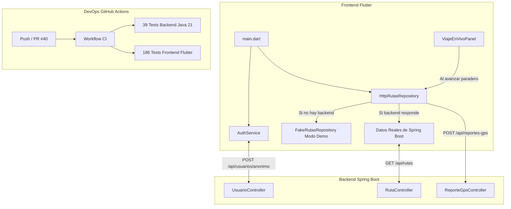

# Reporte de Avance Adicional — Integración Backend, Telemetría y CI/CD

**Proyecto:** PiuraGo — Sistema Colaborativo de Monitoreo y Rutas de Transporte Urbano en Piura  
**Curso:** Integrador I — Universidad Tecnológica del Perú (UTP)  
**Hito Complementario:** Fase de Integración Cliente-Servidor y DevOps  
**Fecha:** 26 de octubre de 2026  
**Pull Request Asociado:** [#40 — Proyecto en revisión: Congestión, Viaje en Vivo y Conexión HTTP](https://github.com/miacordov/piurago/pull/40)  

---

## 1. Resumen de los Nuevos Avances

Desde la entrega del informe anterior, el desarrollo se enfocó en materializar la **comunicación cliente-servidor real**, la **tolerancia a fallos sin conexión**, la **automatización de pruebas en la nube (CI/CD)** y la **formalización del Pull Request final**.

---

## 2. Nuevos Componentes Desarrollados

### 2.1 Servicio de Autenticación JWT (`auth_service.dart`)
- **Ruta:** `frontend/lib/data/api/auth_service.dart`
- **Funcionalidad:**
  - **Identificación de dispositivo:** Genera y persiste un identificador único `deviceUuid` para pasajeros anónimos.
  - **Emisión de tokens:** Consume el endpoint `POST /api/usuarios/anonimo` para obtener un token JWT sin requerir registro previo.
  - **Usuarios registrados:** Métodos `login(email, password)` y `registrar(nombre, email, password)` para usuarios con credenciales.
  - **Gestión de cabeceras:** Retiene el token en memoria para firmar cada llamada protegida con `Authorization: Bearer <token>`.

### 2.2 Repositorio HTTP con Fallback Inteligente (`http_rutas_repository.dart`)
- **Ruta:** `frontend/lib/data/api/http_rutas_repository.dart`
- **Funcionalidad:**
  - Implementa la interfaz `RutasRepository`, garantizando desacoplamiento total en la UI.
  - **Consumo REST:** Llama a `GET /api/rutas` y `GET /api/rutas/{id}/paraderos`.
  - **Tolerancia a fallos (*Offline Fallback*):** Si el servidor Spring Boot está apagado o no hay acceso a la red, conmuta automáticamente a `FakeRutasRepository`. La app no colapsa ni muestra pantallas en blanco; simplemente activa la píldora informativa *"Modo demostración"*.
  - **Cálculo de ETA:** Método `obtenerEta(idRuta)` contra `GET /api/reportes-gps/eta/{idRuta}`.

### 2.3 Telemetría GPS en Tiempo Real (`map_page.dart` y `viaje_en_vivo_panel.dart`)
- Se vinculó el callback `onParaderoAlcanzado` en `ViajeEnVivoPanel`.
- Cada vez que el pasajero avanza de paradero o activa el botón **«Simular avance»**, la app despacha una petición `POST /api/reportes-gps` con:
  - `idRuta`: Identificador de la combi abordada.
  - `latitud` y `longitud`: Coordenadas geográficas del paradero actual.
- Esto alimenta en el backend el histórico de congestión y el cálculo de demoras en vivo.

### 2.4 Inyección Configurable en el Punto de Entrada (`main.dart`)
- Se actualizó `frontend/lib/main.dart` para instanciar `HttpRutasRepository` y `AuthService` por defecto apuntando a `http://localhost:8080`.
- Soporta configuración externa vía `--dart-define=API_URL=...` para entornos móviles o producción.

---

## 3. Automatización y DevOps: GitHub Actions (CI/CD)

Se creó el pipeline automatizado en `.github/workflows/ci.yml` para garantizar la integración continua en cada subida:

- **Archivo:** `.github/workflows/ci.yml`
- **Jobs configurados:**
  1. `backend-test`:
     - Entorno: `ubuntu-latest` con JDK 21 Eclipse Temurin.
     - Tarea: Ejecución de las 39 pruebas unitarias de Spring Boot (`JwtUtilTest`, `*ServiceImplTest`) con Maven Wrapper.
  2. `frontend-test`:
     - Entorno: `ubuntu-latest` con Flutter estable.
     - Tarea: `flutter pub get`, análisis estático con `flutter analyze` y ejecución de las 186 pruebas de widgets y lógica.
- **Disparadores:** Activación automática en cada `push` a ramas `feature/**` o `main`, y en cada `pull_request`.

---

## 4. Evolución de las Métricas de Pruebas (TDD)

| Métrica | Reporte Anterior | Estado Actual | Variación |
|---|---|---|---|
| **Pruebas Frontend (Flutter)** | 178 | **186** | **+8 pruebas** |
| **Pruebas Backend (Spring Boot)** | 39 | **39** | Sin cambios (100% pasando) |
| **Total de Pruebas Automatizadas** | 217 | **225** | **+8 pruebas** |
| **Incidencias Linter (`flutter analyze`)** | 0 | **0** | Código limpio |

### Nuevas pruebas añadidas:
1. `test/data/auth_service_test.dart`:
   - Emisión de token anónimo con UUID.
   - Reutilización de token sin peticiones redundantes.
   - Actualización de sesión en login de usuario registrado.
   - Cierre de sesión y limpieza de memoria.
2. `test/data/http_rutas_repository_test.dart`:
   - Petición `GET /api/rutas` con cabecera Bearer token.
   - Petición `GET /api/rutas/{id}/paraderos`.
   - Envío de telemetría `POST /api/reportes-gps`.
   - Conmutación automática a fallback ante error de red.

---

## 5. Formalización en GitHub: Pull Request #40

Se consolidó todo el trabajo de la sesión en la rama `feature/frontend-integracion-backend` y se generó el **Pull Request oficial #40** en el repositorio:

- **Enlace del PR:** [https://github.com/miacordov/piurago/pull/40](https://github.com/miacordov/piurago/pull/40)
- **Título:** `Proyecto en revisión: Congestión, Viaje en Vivo y Conexión HTTP`
- **Autor:** `Ivan26-c`
- **Commits integrados:** 8 commits bajo el estándar de conventional commits:
  1. `test(frontend): prueba la pantalla de congestión y franjas horarias`
  2. `feat(frontend): agrega la pantalla de congestión con gráficos de horario y tramos críticos`
  3. `test(frontend): prueba el flujo de abordaje y viaje en vivo`
  4. `feat(frontend): implementa confirmación de abordaje y viaje en vivo colaborativo`
  5. `docs(docs): agrega reporte técnico formal de avance APF3`
  6. `test(frontend): prueba la autenticación JWT y el cliente HTTP con fallback`
  7. `feat(frontend): implementa cliente HTTP con JWT, reporte GPS y fallback a demo`
  8. `ci(github): configura pipeline de integración continua para backend y frontend`
- **Volumen de cambios:** 22 archivos modificados / creados (+2,453 líneas agregadas).
- **Checks en ejecución:** Pipeline de GitHub Actions ejecutando validaciones automáticas.
